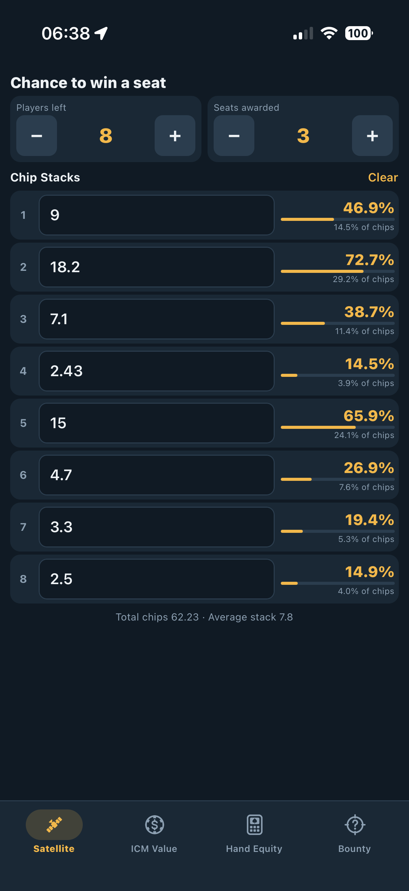
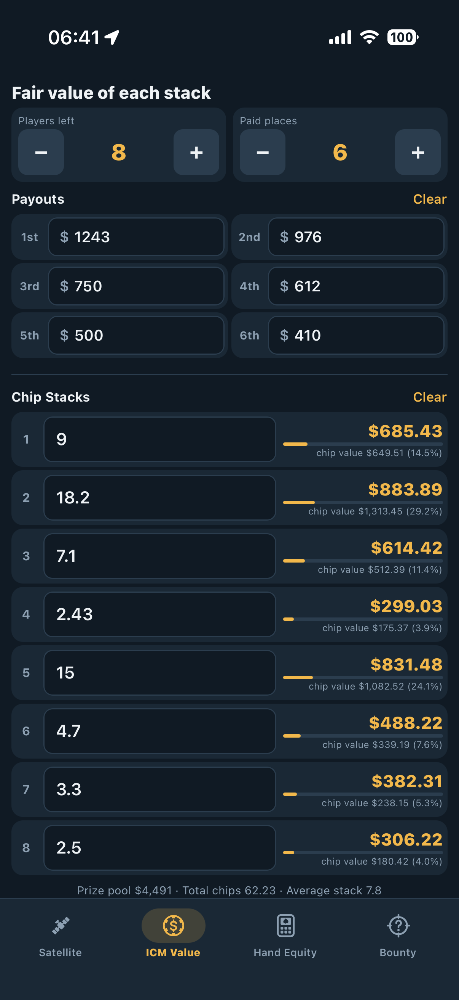
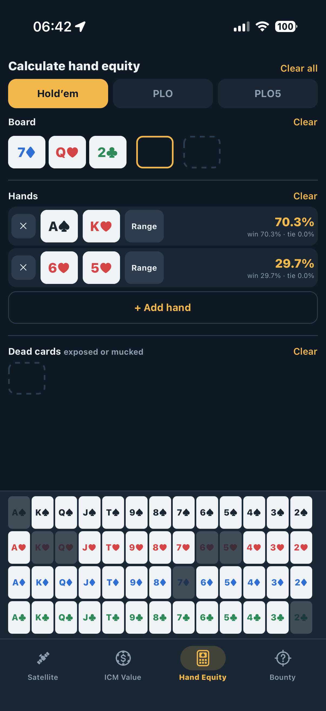

# ICM Poker Tools

A pocket toolkit for tournament poker players. It has four calculators in one dark-themed mobile app, built with Expo and React Native:

| Satellite | ICM Value | Hand Equity |
| :---: | :---: | :---: |
|  |  |  |

## Calculators

### Satellite: chance to win a seat
Set the players left and the number of seats awarded, then enter each player's chip stack. For each stack you get the probability of finishing in a seat, next to its share of the chips in play. In a satellite every seat is worth the same, so a stack's equity is its chance to finish in the top *N*.

### ICM Value: fair value of each stack
Enter the payouts for each paid place and every player's chip stack. Each stack gets its Independent Chip Model (ICM) dollar value, shown against its raw chip value (the stack's share of the prize pool). The gap between the two numbers is what ICM pressure costs a big stack and gives a short one.

### Hand Equity
- Supports **Hold'em, PLO and PLO5**, with up to 10, 9 and 8 hands.
- Tap a slot, then tap cards in the picker to fill hole cards, the board (preflop, flop, turn or river) and dead cards.
- In Hold'em, any hand can be switched to a **range** that you pick on a 13×13 grid.
- Shows win, tie and total equity for every hand. Results update live as you change cards.
- Each section has its own **Clear**, and **Clear all** resets the whole screen.

### Bounty: mystery bounty value
- Enter how many bounties of each size are left in the pool. The app shows the expected value of your next knockout and the chance of drawing each size.
- Tap **−** each time a bounty of a given size is drawn.
- Converts the bounty into chips and big blinds, based on prize money left and chips in play.
- Shows how much the bounty lowers the equity you need to call an all-in you cover.

Inputs on the Satellite, ICM and Bounty screens are saved on the device, so they are still there the next time you open the app.

## How the math works

| Calculator | Method |
| --- | --- |
| Satellite and ICM | Malmuth-Harville model: the next player to bust is picked in proportion to chip stack. Exact for up to 20 players. Satellite uses a numerical integral above that; ICM uses Monte Carlo. |
| Hand equity | Every runout is enumerated when that's cheap (most flop, turn and river spots). Preflop and range spots are sampled, with a running estimate that firms up as samples come in. Omaha hands must use exactly 2 hole cards and 3 board cards. |
| Bounty | A knockout draws a random bounty from the ones left, so it's worth the pool's average. Chip value assumes every chip is worth the same (prize money left ÷ chips in play). |

All calculations run on the device in plain JavaScript. The app makes no network calls.

## Getting started

Requirements: Node.js, plus Xcode for iOS or Android Studio for Android.

```bash
npm install
npx expo start         # dev server (Expo Go or a dev build)
npx expo run:ios       # build and run on iOS
npx expo run:android   # build and run on Android
npx expo lint          # lint
```

## Project layout

```
src/
  App.js         custom bottom tab bar and screen switching
  screens/       one screen per calculator
  components/    shared UI: card picker, range editor, steppers, inputs
  hooks/         persistent state, background equity calculation
  lib/           pure math: icm, satellite, bounty, equity, ranges, cards
  theme.js       color tokens
  styles.js      shared styles
```

The code in `src/lib/` has no React dependencies. Each module there can be used or tested by itself.

## Design notes

- **Plain JavaScript, custom tab bar.** The app avoids Expo Router and other packages with native code, so most changes only need a JS reload and no new native build.
- **The UI stays responsive.** Equity runs in short time slices that yield back to the UI. When the inputs change, any run still in progress is cancelled.
